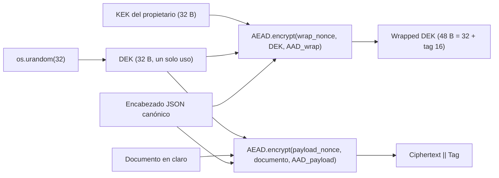
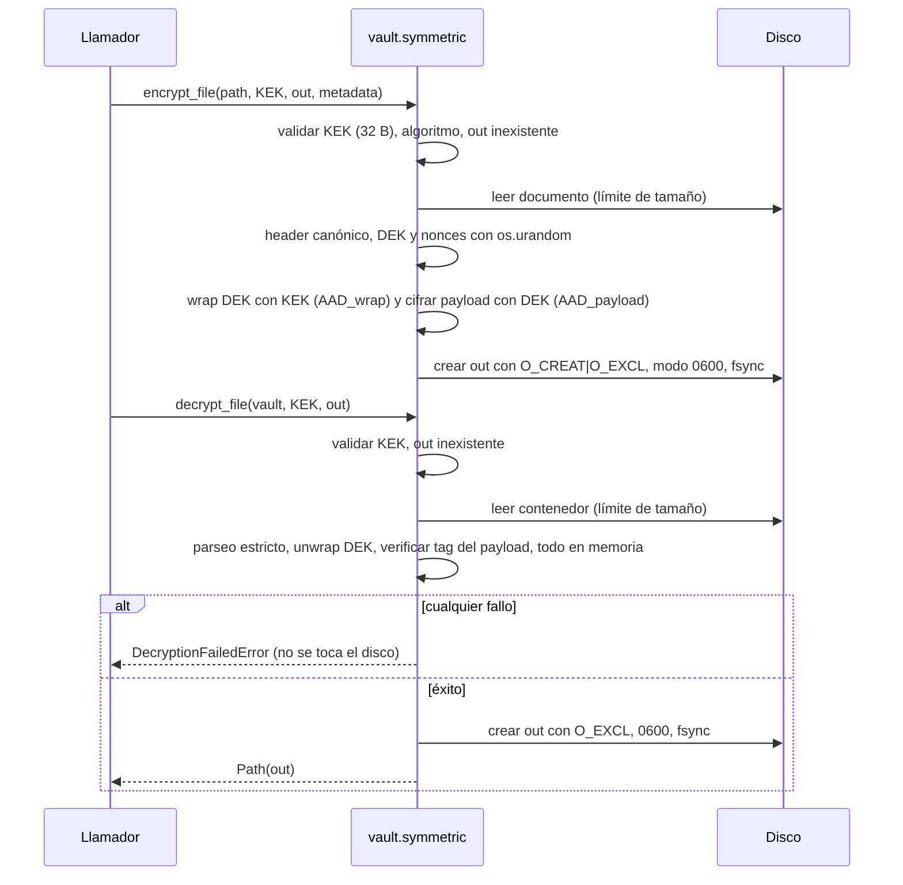
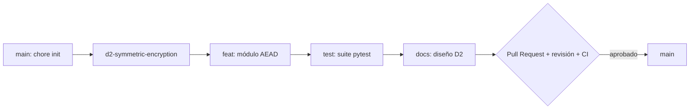

# D2 — Módulo de cifrado simétrico autenticado

**Proyecto:** Secure Digital Document Vault
**Módulo:** [`vault/symmetric.py`](../vault/symmetric.py) · Excepciones: [`vault/exceptions.py`](../vault/exceptions.py) · Pruebas: [`tests/test_symmetric.py`](../tests/test_symmetric.py)
**Rama:** `d2-symmetric-encryption`

---

## 1. Objetivo

Garantizar **confidencialidad**, **integridad** y **detección de manipulaciones** de los documentos de un único
propietario mediante cifrado autenticado (AEAD) con *envelope encryption*.

> **Objetivo de seguridad.** Un atacante que obtenga el contenedor cifrado no puede leer su contenido ni modificar
> un solo bit de los datos **o de los metadatos** sin que el descifrado falle inmediatamente, de forma segura y
> sin emitir datos parciales.

---

## 2. Diseño

### 2.1 Primitivas y parámetros

| Parámetro | Valor | Comentario |
|---|---|---|
| Biblioteca | `cryptography >= 44.0.0` (API AEAD de alto nivel) | Ninguna primitiva implementada a mano |
| AEAD por defecto | **AES-256-GCM** (`AESGCM`) | Acelerado por hardware (AES-NI + PCLMULQDQ) |
| AEAD alternativo | ChaCha20-Poly1305 (`ChaCha20Poly1305`) | Parámetro `algorithm=`; recomendable sin AES-NI |
| Clave de usuario (KEK) | 256 bits (32 B) | Se rechaza cualquier otra longitud, incluso 128/192 bits que `AESGCM` aceptaría |
| Clave de datos (DEK) | 256 bits, **nueva por archivo** | `os.urandom(32)` |
| Nonce | 96 bits (12 B) | `os.urandom(12)`; tamaño recomendado por NIST SP 800-38D |
| Tag | 128 bits (16 B) | Nunca truncado |
| Fuente de aleatoriedad | CSPRNG del SO (`os.urandom` → `getrandom(2)`) | Prohibido `random`; verificado por prueba estática (AST) |

Ambos algoritmos comparten tamaño de clave, nonce y tag, por lo que el formato del contenedor es idéntico; el
algoritmo usado queda registrado (y autenticado) en el encabezado.

### 2.2 Envelope encryption



Ventajas: (1) la KEK sólo cifra 32 bytes por archivo, lo que mantiene muy bajo su número de usos; (2) la rotación
de la KEK sólo requiere re-envolver las DEK, no re-cifrar los documentos; (3) cada documento tiene una clave
independiente, de modo que el compromiso de una DEK no afecta a los demás.

### 2.3 Ciclo de vida del nonce

| Nonce | Clave bajo la que se usa | Generación | Unicidad |
|---|---|---|---|
| `payload_nonce` | DEK del archivo | `os.urandom(12)` | **Absoluta por construcción:** la DEK es nueva y se usa para exactamente un cifrado, por lo que el par *(clave, nonce)* jamás se repite. |
| `wrap_nonce` | KEK del propietario | `os.urandom(12)` | Probabilística: la probabilidad de colisión tras *q* envoltorios es ≈ *q*² / 2⁹⁷. Con el límite de NIST (2³² invocaciones por clave con nonces aleatorios) la probabilidad es ≤ 2⁻³³. Un único propietario no se acerca a ese volumen. |

Reglas aplicadas:

1. Los nonces se generan **inmediatamente antes** de cada operación y se escriben en el contenedor; nunca se derivan
   del tiempo, de contadores en memoria ni de semillas.
2. Nunca se reutiliza un nonce: re-cifrar el mismo archivo produce DEK, nonces, DEK envuelta, ciphertext y tag nuevos
   (prueba `TestUniqueness`).
3. En descifrado, los nonces se leen del contenedor y además forman parte del AAD del payload.
4. La DEK se descarta (`del`) tras su uso. CPython no permite borrar memoria de forma garantizada (ver §3.3).

### 2.4 Formato del contenedor

Enteros en *big-endian*. `N` = longitud del encabezado, `M` = longitud del documento (GCM preserva la longitud).

| Offset | Tamaño | Campo | Protección |
|---|---|---|---|
| 0 | 4 B | Magic `SDDV` | AAD de ambos AEAD |
| 4 | 4 B | Longitud del encabezado `N` (`uint32`) | AAD de ambos AEAD |
| 8 | N B | Encabezado JSON canónico (en claro) | AAD de ambos AEAD |
| 8+N | 12 B | Wrap nonce | Entrada del AEAD de la DEK + AAD del payload |
| 20+N | 48 B | DEK envuelta (32 B cifrados + tag 16 B) | Tag propio + AAD del payload |
| 68+N | 12 B | Payload nonce | Entrada del AEAD del payload + AAD del payload |
| 80+N | M B | Ciphertext | Tag del payload |
| 80+N+M | 16 B | Tag | — |

Tamaño total = `96 + N + M` bytes.

**Vinculación (AAD):**

```text
AAD_wrap    = magic ‖ len ‖ header
AAD_payload = magic ‖ len ‖ header ‖ wrap_nonce ‖ wrapped_dek ‖ payload_nonce
```

`AAD_payload` es exactamente todo lo que precede al ciphertext, de modo que **cada byte del contenedor está cubierto
por al menos un tag**. La prueba `test_exhaustive_every_bit_of_container_is_authenticated` invierte cada uno de los
bits de un contenedor y comprueba que todas las variantes son rechazadas. Además, `AAD_wrap` liga la DEK envuelta a
*su* encabezado: no se puede trasplantar una DEK envuelta (ni un encabezado) entre contenedores.

### 2.5 Encabezado (metadatos autenticados)

Ejemplo real (los metadatos viajan **en claro**):

```json
{"alg":"AES-256-GCM","created_at":"2026-10-14T16:32:37Z","filename":"doc.pdf","key_bits":256,"key_wrap":"AES-256-GCM","metadata":{"owner":"alice"},"nonce_bytes":12,"tag_bytes":16,"version":1}
```

| Campo | Obligatorio | Descripción |
|---|---|---|
| `version` | Sí | Versión del formato (`1`) |
| `alg` / `key_wrap` | Sí | AEAD del payload y del envoltorio de la DEK (allow-list) |
| `key_bits`, `nonce_bytes`, `tag_bytes` | Sí | Parámetros criptográficos (`256`, `12`, `16`) |
| `created_at` | Sí | Timestamp UTC ISO-8601 (`YYYY-MM-DDTHH:MM:SSZ`) |
| `filename` | No | Nombre original (`include_filename=False` para omitirlo) |
| `metadata` | No | Diccionario JSON del usuario |

**Serialización canónica:** claves ordenadas, sin espacios (`separators=(",", ":")`), sólo ASCII
(`ensure_ascii=True`), sin `NaN`/`Infinity`. Al cifrar se exige además un *round-trip* exacto (rechaza tuplas, claves
no `str`, referencias circulares). Tamaño máximo: 64 KiB.

**Parseo estricto al descifrar** (antes de autenticar, se trata como dato hostil): ASCII estricto, JSON sin claves
duplicadas ni constantes no finitas, re-serialización canónica idéntica byte a byte, campos exactos (sin desconocidos),
tipos exactos (`True` no se acepta como `1`) y parámetros dentro de la allow-list. Aunque los bytes crudos ya están
autenticados, esto elimina ataques de *parser differential* y de *downgrade* de algoritmo. El encabezado sólo se
devuelve al llamador **después** de verificar ambos tags.

> [!NOTE]
> La canonicalización es determinista y estricta, inspirada en RFC 8785 (JCS), pero no lo implementa al 100 %
> (orden de claves por *code point* y formato de flotantes de Python). No afecta a la seguridad porque se autentican
> los bytes exactos que viajan en el contenedor.

### 2.6 Flujos



### 2.7 Manejo de errores y del disco

* **Una sola excepción, un solo mensaje:** cualquier fallo al abrir un contenedor (clave errónea, tag inválido,
  bit modificado en datos o metadatos, truncado, JSON inválido, versión/algoritmo no soportado) produce
  `DecryptionFailedError("Decryption failed: the container is invalid, has been tampered with, or the key is incorrect.")`.
* **Sin encadenamiento:** la excepción se lanza *fuera* del bloque `except`, de modo que `__cause__` y `__context__`
  son `None`; un traceback no revela si falló el parseo, el desenvolvimiento de la DEK o el tag del payload.
* **Errores del llamador** (no controlables por un atacante) son descriptivos: `InvalidKeyError`,
  `InvalidMetadataError`, `UnsupportedAlgorithmError`, `PlaintextTooLargeError` (todas `VaultError` + `ValueError`).
* **Verificar antes de escribir:** el descifrado completo ocurre en memoria con la API *one-shot* de `cryptography`,
  que no devuelve texto plano si el tag no verifica. El archivo de salida se crea **sólo tras el éxito**.
* **Sin archivos temporales ni residuos:** la salida se crea con `O_CREAT | O_EXCL` (no sigue ni sobrescribe
  archivos o *symlinks* existentes), permisos `0600` y `fsync`. Si la escritura falla a mitad (p. ej. `ENOSPC`), el
  archivo parcial se elimina antes de propagar el `OSError`.
* **Nunca se sobrescribe** un archivo existente (`FileExistsError`).
* **Nombre de salida decidido por el llamador:** el `filename` del encabezado nunca se usa como ruta, lo que evita
  *path traversal*.

### 2.8 API pública

```python
encrypt_file(file_path: Path, owner_key: bytes, output_path: Path,
             metadata: Optional[dict] = None, *, algorithm="AES-256-GCM",
             include_filename=True) -> Path
decrypt_file(vault_file_path: Path, owner_key: bytes, output_path: Path) -> Path

# Variantes en memoria, reutilizables por entregables posteriores
encrypt_bytes(plaintext, owner_key, *, metadata=None, filename=None, algorithm=...) -> bytes
decrypt_bytes(container, owner_key) -> DecryptedDocument(plaintext, header)
generate_owner_key() -> bytes   # 32 B del CSPRNG del SO
```

---

## 3. Justificación de seguridad

### 3.1 ¿Por qué AEAD y no «cifrado + hash» (p. ej. AES-CBC + SHA-256)?

1. **Un hash no es un autenticador.** `SHA-256(ciphertext)` no usa clave: un atacante modifica el ciphertext y
   recalcula el hash. Haría falta un **MAC con clave** (HMAC), una segunda clave independiente y una comparación en
   tiempo constante.
2. **El orden importa y es fácil equivocarse.** Sólo *Encrypt-then-MAC* es genéricamente seguro. *MAC-then-Encrypt*
   con CBC ha producido ataques reales de *padding oracle* (Vaudenay 2002, Lucky 13, POODLE), que recuperan el
   texto plano byte a byte a partir de errores o tiempos distintos.
3. **Hay que acordarse de autenticar todo:** IV, metadatos, algoritmo y longitudes. Olvidar el IV o los metadatos en
   el MAC permite manipulaciones (p. ej. alterar el primer bloque CBC modificando el IV).
4. **CBC requiere *padding*** y un IV impredecible; GCM y ChaCha20-Poly1305 no tienen padding, lo que elimina por
   completo la clase de ataques de padding oracle.
5. **AEAD es una primitiva estándar y analizada** (IND-CCA2 + INT-CTXT) que entrega confidencialidad, integridad y
   **datos asociados (AAD)** en una sola llamada, con una API que *verifica antes de devolver* el texto plano. Menos
   piezas = menos superficie de error de implementación. Además AES-GCM es más rápido que CBC + HMAC en hardware
   moderno.

### 3.2 Consecuencias catastróficas de reutilizar un nonce en GCM

GCM = cifrado CTR + autenticador GHASH con clave `H = AES_K(0¹²⁸)`. Si se cifran dos mensajes con la misma clave y
el mismo nonce:

1. **Pérdida de confidencialidad:** el *keystream* CTR se repite, así que `C₁ ⊕ C₂ = P₁ ⊕ P₂`. Conocer o adivinar
   parte de un documento (cabeceras PDF, plantillas) revela la parte correspondiente del otro.
2. **Pérdida total de autenticidad (*forbidden attack*, Joux 2006; Böck et al. 2016):** los dos tags dan un sistema
   polinómico sobre GF(2¹²⁸) cuya raíz es `H`. Recuperado `H` (y la máscara del tag), el atacante puede **falsificar
   tags válidos para mensajes arbitrarios** bajo esa clave y nonce, y modificar ciphertexts a voluntad sin ser
   detectado. La integridad deja de existir.
3. **Contagio vía KEK:** en nuestro esquema, una colisión de `wrap_nonce` bajo la KEK revelaría `DEK₁ ⊕ DEK₂` y la
   clave GHASH del envoltorio, permitiendo forjar DEK envueltas.
4. ChaCha20-Poly1305 sufre el mismo fallo (reutilización de *keystream* y de la clave de un solo uso de Poly1305).

**Mitigaciones en este diseño:** DEK nueva por archivo (el nonce del payload es único por construcción); nonces de
96 bits del CSPRNG del SO; la KEK sólo envuelve 32 B por archivo, muy por debajo del límite de 2³² invocaciones;
prueba automatizada de unicidad sobre 300 cifrados y prueba que verifica que **toda** la aleatoriedad proviene de
`os.urandom` (exactamente 32 + 12 + 12 bytes por archivo).

### 3.3 Modelo de amenazas

**Activos:** contenido de los documentos (confidencialidad + integridad) y metadatos del encabezado (integridad).

**Atacante considerado:** controla el almacenamiento o el canal donde reside el contenedor (disco robado, nube,
backup, red). Puede **leer, copiar, modificar, truncar, extender, reordenar y trasplantar** bytes o contenedores
completos; conoce el formato y el código; puede obtener contenedores de textos que él elija. **No** conoce la KEK
ni controla el equipo del propietario.

| Ataque | Defensa |
|---|---|
| Leer el documento | AES-256-GCM / ChaCha20-Poly1305 con DEK de 256 bits |
| Modificar ciphertext, tag o nonces | Fallo del tag → `DecryptionFailedError` |
| Modificar metadatos (nombre, fecha, algoritmo, versión) | Encabezado ligado como AAD a ambos AEAD |
| *Downgrade* de algoritmo/parámetros | Allow-list + parámetros autenticados |
| Trasplantar DEK envuelta / encabezado entre contenedores | `AAD_wrap` y `AAD_payload` |
| Truncar / añadir bytes | Longitudes autenticadas + tag final |
| Oráculo de errores / padding oracle | Error único sin encadenar; AEAD sin padding |
| Fuerza bruta de clave | Espacio de 2²⁵⁶ |
| Sobrescritura / *symlink* en la ruta de salida | `O_EXCL`, rechazo de rutas existentes |

**Fuera de alcance en esta fase (riesgos aceptados):**

* **Replay / rollback:** una versión **antigua pero válida** de un contenedor se descifra correctamente; no hay
  noción de frescura. *Mitigación futura:* manifiesto autenticado con versión monotónica por documento.
* **Sustitución de documentos completos** del mismo propietario (intercambiar `a.vault` por `b.vault`): ambos son
  auténticos. La aplicación puede comparar el `filename` autenticado con el esperado; un identificador de documento
  ligado al índice del vault se abordará después.
* **Eliminación** de contenedores (disponibilidad / DoS).
* **Confidencialidad de metadatos y del tamaño:** el encabezado va en claro y la longitud del ciphertext revela el
  tamaño exacto. Usar `include_filename=False` y no poner secretos en `metadata`.
* **Gestión de la KEK:** generación, almacenamiento y derivación desde contraseña (Argon2id/scrypt) corresponden a
  un entregable posterior.
* **Compromiso del equipo:** malware, depuradores, volcados de memoria, *swap*, ataques *cold boot*. CPython no
  garantiza el borrado de claves en memoria (objetos `bytes` inmutables).
* **Borrado seguro en disco:** al eliminar un archivo parcial tras un fallo de E/S, los bloques físicos pueden
  persistir (journaling, *wear leveling* en SSD). Recomendado: cifrado de disco completo.
* **Canales laterales locales** de tiempo/caché (dependemos de la implementación constante de OpenSSL). El tiempo de
  fallo distingue «falla en el envoltorio» de «falla en el payload», pero eso no da ventaja: el atacante ya sabe qué
  bytes alteró y GCM no tiene padding que filtrar.
* **Key commitment:** GCM y Poly1305 no son *key-committing* (ataques tipo *invisible salamanders*). Con un único
  propietario y una única KEK el riesgo es bajo; será relevante cuando haya varios destinatarios.
* **Multiusuario, firmas y no repudio:** fuera del alcance de D2.

---

## 4. Trazabilidad de pruebas

| Requisito | Pruebas (`tests/test_symmetric.py`) |
|---|---|
| 1. Ciclo completo byte a byte | `TestRoundTrip::test_file_roundtrip_is_byte_identical` (0 B a 1 MiB, ambos algoritmos), layout, encabezado canónico, Unicode |
| 2. Clave incorrecta sin archivo | `TestWrongKey` (clave aleatoria, a 1 bit de distancia, longitudes/tipos inválidos) |
| 3. Ciphertext manipulado | `TestCiphertextTampering` (bit aleatorio ×25, cada región, **todos los bits del contenedor**, truncado, extendido, trasplantes) |
| 4. Metadatos manipulados | `TestMetadataTampering` (13 mutaciones semánticas, cada byte del encabezado, JSON no canónico, claves duplicadas, longitud) |
| 5. Unicidad de salida | `TestUniqueness` (nonces, DEK envueltas, ciphertexts y tags distintos; 300 cifrados; sólo `os.urandom`; sin `random`) |
| 6. Fallos en disco | `TestDiskSafety` (sin salida ni residuos tras fallos, no sobrescribe, rechaza *symlinks*, `ENOSPC` simulado borra el parcial) |
| Sin oráculos | `TestErrorHygiene` (mismo tipo y mensaje en 8 modos de fallo; sin `__cause__`/`__context__`) |

Ejecución:

```bash
.venv/bin/python -m pytest -v
```

---

## 5. Limitaciones y trabajo futuro

* **Tamaño máximo ≈ 2 GiB** por la API *one-shot* (deliberada: garantiza no emitir texto plano sin verificar).
  Para archivos mayores: AEAD por segmentos (construcción STREAM, como *streaming AEAD* de Tink o `age`), con
  nonce = prefijo ‖ contador ‖ flag de último segmento.
* Derivación de la KEK desde contraseña (Argon2id) y almacenamiento seguro.
* Protección contra *rollback* y rotación de la KEK (re-envolver DEK sin re-cifrar documentos).

---

## 6. Flujo de Git

### 6.1 Estructura de ramas



### 6.2 Comandos

```bash
# 1. Repositorio y rama principal (sólo la primera vez)
git init -b main
git add .gitignore
git commit -m "chore: initialize repository"

# 2. Rama de trabajo del entregable
git switch -c d2-symmetric-encryption

# 3. Commits atómicos (Conventional Commits)
git add vault/ requirements.txt requirements-dev.txt pytest.ini
git commit -m "feat(vault): AEAD envelope encryption module (AES-256-GCM, per-file DEK)"
git add tests/
git commit -m "test(vault): exhaustive pytest suite for D2 symmetric module"
git add docs/ README.md .github/
git commit -m "docs: D2 design, security rationale and threat model"

# 4. Publicar (sustituir <usuario>/<repo>)
git remote add origin git@github.com:<usuario>/<repo>.git
git push -u origin main
git push -u origin d2-symmetric-encryption

# 5. Abrir el Pull Request (GitHub CLI o la interfaz web)
gh pr create --base main --head d2-symmetric-encryption \
  --title "D2: Symmetric authenticated encryption module" \
  --body "Implementa vault/symmetric.py (AES-256-GCM + envelope encryption). Ver docs/design_d2.md."
```

### 6.3 Reglas de revisión antes de mergear a `main`

1. **Protección de rama** en GitHub (*Settings → Branches → Add rule* para `main`): exigir Pull Request, al menos
   **1 aprobación**, que pase el *status check* `tests` (workflow [`.github/workflows/tests.yml`](../.github/workflows/tests.yml)),
   resolver todas las conversaciones y prohibir *push* directo y *force-push*.
2. El revisor usa la lista de verificación de [`.github/pull_request_template.md`](../.github/pull_request_template.md)
   (aleatoriedad, nonces, AAD, manejo de errores, ausencia de secretos en el repositorio).
3. Correcciones en la misma rama (`git commit` + `git push`); el PR se actualiza solo.
4. Tras la aprobación: **Squash and merge** (o *merge commit* si se desea conservar los commits atómicos) y
   eliminar la rama:

   ```bash
   git switch main && git pull --ff-only
   git branch -d d2-symmetric-encryption
   git push origin --delete d2-symmetric-encryption
   ```
